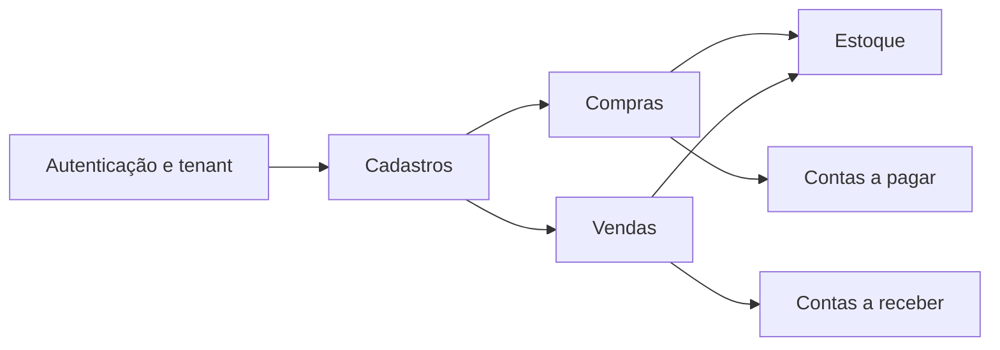

# Mapa de domínios - ERP SaaS

O desenho é conceitual. Nomes de classes, relacionamentos e constraints devem ser validados frente às entities Java, repositórios e migrations Flyway.

## Regras de integridade relevantes

- SKU deve ser único **por tenant**.
- Saldo de estoque associado de forma única a cada par tenant/produto.
- Pedidos e documentos financeiros não podem referenciar dados de outra empresa.
- Valores financeiros podem divergir da soma dos itens por impostos, descontos, frete e ajustes, com rastreabilidade.
- Cancelamentos devem preservar integridade transacional e estornos corretos.
- Soft delete e unicidade precisam ter política explícita de reutilização de identificadores.
